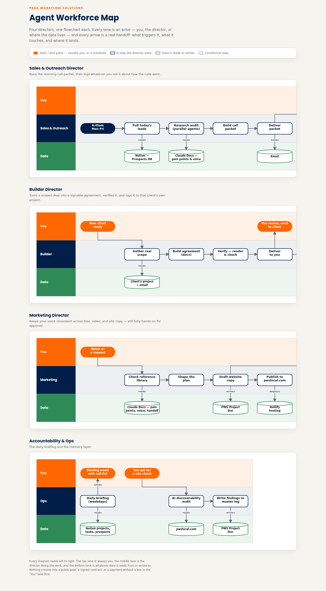

# The Agent Workforce

I run Peak Workflow Solutions solo. The agent workforce is how one person runs sales, operations, delivery, and marketing at the same time.



Interactive version: [agent-workforce-map.html](agent-workforce-map.html)

## Org structure

It's a two-tier org, not a pile of separate bots.

```
                      Marcos (intent + escalations)
                                 │
                     Project Manager (orchestrator)
                                 │
   ┌──────────────┬──────────────┼──────────────┬──────────────────┐
Operations     Sales &        Builder       Client           Marketing
Manager        Outreach                     Relationship
```

| Director | What it owns | How it's built |
|---|---|---|
| **Operations Manager** | Daily briefing: projects, tasks, bottlenecks, today's call list | [Zapier + Claude scheduled task](operations-manager/) |
| **Sales & Outreach** | Inbox triage and draft replies, morning cold-call prep, call logging, web lead capture | [Triage](sales-outreach-triage/), [Call prep](cold-call-prep/), [Lead capture](website-lead-capture/), skills |
| **Builder** | Runs a client engagement: diagnose, design, build, test, document, plus contracts | [`pws-builder`](../skills/pws-builder/), [`pws-client-paperwork`](../skills/pws-client-paperwork/), [`pws-meeting-intake`](../skills/pws-meeting-intake/), [contract generator](../projects/contract-generator/) |
| **Client Relationship** | Check-ins, status updates, renewals after delivery | Process defined in the Builder and paperwork skills (retainer, monitoring, response time) |
| **Marketing** | One recorded video or idea becomes posts for every platform, in my voice | [Weekly ideas agent](weekly-post-ideas/), [`pws-motion-a-content`](../skills/pws-motion-a-content/), [`content-lead-gen-playbook`](../skills/content-lead-gen-playbook/) |
| **Project Manager** | Sits over the Directors, routes work, escalates only what needs me | Escalation rules: money, anything client-facing, anything irreversible |

Also running: a personal [Job Board Agent](job-board-agent/).

## Principles

- **Automation vs. agent.** Automation is fixed steps with no judgment. An agent uses AI to look at a situation and act differently based on what it finds. Zapier is plumbing. Claude is judgment.
- **Build for the problem you have.** Every agent starts simple with just enough judgment to be useful. Sophistication comes after real use shows where it's needed.
- **Human in the loop where it matters.** Agents draft; I send. Nothing client-facing goes out without me.
- **No fabrication.** Agents report "not found" instead of guessing. Every stat used in marketing is sourced.
- **AI stays out of the human moment.** Automate the admin around the service, never the part where a person is being served by a person.

## Build order and why

1. Operations Manager → Sales & Outreach → Marketing content (solo phase, used to land client #1)
2. Builder → Client Relationship (once a real client engagement existed to spec them from)
3. Project Manager over the top once there's enough to orchestrate

Agents built for my own business aren't automatically products. The workforce is the engine that lets me deliver solo. The products are the repeatable client builds in [`/projects`](../projects/) and [`/skills`](../skills/).

## Scheduled agents at a glance

| Agent | Schedule | Connectors |
|---|---|---|
| Operations Manager briefing | Weekdays, early morning | Notion, Gmail |
| Sales & Outreach triage | Daily | Gmail, Notion |
| Cold Call Prep | Weekdays 6:45 AM | Notion, web research, Docs |
| Weekly Post Ideas | Fridays | Notion, Gmail |
| Job Board refresh | Every 3 days | Indeed, ZipRecruiter, Dice |
