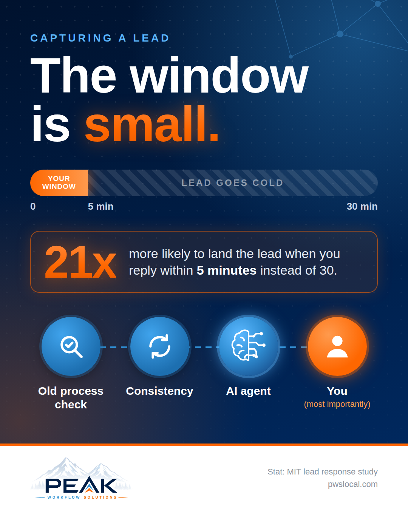

# Marketing System

**Status:** Complete. Running weekly.

The Marketing Director's content motion: turn real work into consistent local content without it eating the week.

## Pipeline

```
Friday: Weekly Post Ideas agent emails 6 concepts
        │
Weekend: I pick two
        │
Record a short video or write notes
        │
pws-motion-a-content skill drafts copy per platform
(Facebook + local groups, Google Business Profile, Instagram, LinkedIn, YouTube; TikTok only with its own short cut)
        │
Graphics built as HTML → rendered to PNG (headless Chromium)
        │
I review, edit in my own voice, and post Monday and Wednesday
```

Nothing auto-posts. I post every piece myself.

## Rules every piece follows

- **No made-up stats.** Every number is traced to a real study or source before it's used. Commonly repeated marketing stats that can't be traced to a study get dropped.
- **Written voice profile.** Built from my own before-and-after edits so drafts sound like me.
- **Open automation, not a fixed menu.** Specific builds are examples of what's possible, never the full list of what I do.
- **AI stays out of the human moment** of a service business. The admin around it is fair game.

## Graphics

| LinkedIn | Facebook |
|---|---|
|  |  |

Source HTML is in [graphics/](graphics/). Also see the [industry cost carousel generator](../projects/industry-cost-carousel/) and the [missed-call calculator](../projects/missed-call-calculator/).

## Related

- [Weekly Post Ideas agent](../agent-workforce/weekly-post-ideas/)
- [`pws-motion-a-content`](../skills/pws-motion-a-content/) and [`content-lead-gen-playbook`](../skills/content-lead-gen-playbook/) skills
