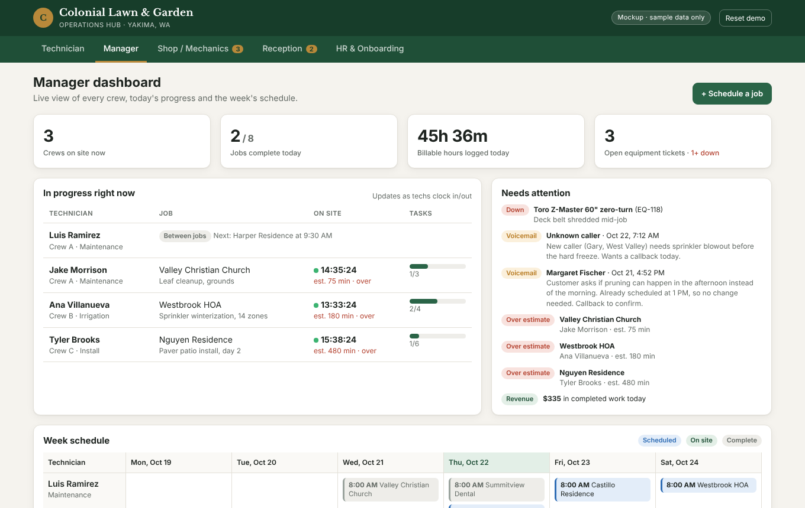

# Colonial Lawn & Garden: Operations Hub (Mockup)

**Status:** Clickable mockup for a pitch. Sample data only, no backend. Nothing here is connected to real systems yet.

A single place where every role at a Yakima landscaping company does its daily work: crews in the field, managers, the equipment shop, reception, and HR.



Open [index.html](index.html) in a browser. It runs from one file and saves demo changes in that browser only. **Reset demo** restores the sample data.

## What each role sees

| Role | Screen | What it does |
|---|---|---|
| Technician | Phone app | Today's route, client details and site notes, the services the client paid for as a checklist, clock in / clock out per job, personal timesheet, report broken equipment |
| Manager | Dashboard | Crews on site right now with live timers vs. estimate, jobs done, hours logged, a "needs attention" feed (equipment down, unreturned voicemails, jobs running over), week schedule by tech, schedule/reassign jobs |
| Shop / Mechanics | Ticket board | New → In Progress → Waiting on Parts → Resolved, repair log per ticket, equipment roster with status that updates from tickets |
| Reception | Call log | Calls and voicemails with recording, transcript and AI summary, filed by receptionist ID (REC-01, REC-02…), full-text search across transcripts, mark voicemails returned |
| HR | Onboarding | New hires with paperwork + training checklists templated by role, progress per person |

## The demo story (how to pitch it)

The pieces are connected, which is the main selling point:

1. Technician tab → open a job → **Clock in**. Manager tab → it's live with a running timer.
2. Technician → **Report equipment issue** (mark it "down"). Shop tab → the ticket is there; the mower shows *Down* on the roster and on the manager's attention feed.
3. Reception → search "sprinkler" → the voicemail transcript with the match highlighted.
4. HR → check off items → progress updates.

## Architecture for the real build (draft)

```
Phone system (records + transcribes) ──webhook──▶ Calls table ──▶ Claude: summary, tags, client match
Tech phone app ──clock in/out, task checks──▶ Jobs + Timesheets tables ──▶ Manager dashboard
Tech app / office ──report issue──▶ Tickets table ──▶ Shop board (+ text to shop lead if "down")
HR ──new hire──▶ Onboarding checklist from role template ──▶ e-sign docs, training sign-offs
```

**Automation (fixed steps, no judgment):** clock in/out, schedule, ticket routing, checklists, progress math, filing calls under receptionist ID.
**Agent layer (Claude judgment):** call/voicemail summaries, tagging (new lead vs. existing client, service type), matching callers to client records, flagging voicemails that need a callback today.

## Direction: custom software they own

Decision: build custom software. The goal is for the company to own all of its data instead of paying separate vendors and agencies for each task.

What "own" means in practice:

- **Every account is in the company's name:** hosting, database, code repository, phone provider, domain. The builder gets access but owns none of them, so the company never depends on a single person to get to its own data.
- **Standard database (Postgres):** the data can be exported or moved to a different host without permission from anyone.
- **Documented:** a written runbook covering how it's deployed, backed up and restored, so another developer could take it over.

Custom doesn't mean building every piece by hand. A few parts are risky or impractical to build, so the system **rents the plumbing but keeps the data**:

| Need | Rent | Keep in our database |
|---|---|---|
| Phone calls | A telephony API (e.g. Twilio) that answers, records and transcribes | Recordings, transcripts, summaries, receptionist IDs |
| Payroll and tax filing | Their existing payroll/accounting tool | Timesheets (exported to payroll) |
| E-signatures | An e-sign service, or a simple signed-PDF flow | Signed documents and completion status |
| AI summaries | Claude API | The summaries and tags it produces |

Proposed stack (draft): a web app that installs on techs' phones from the browser (no app store), with Postgres, login and file storage behind it (e.g. Supabase), hosted on the company's own account.

### Phasing

Don't build all five areas at once. Ship the part with the most daily value first, then let real use shape the rest.

1. **Jobs, scheduling, clock in/out** (technician and manager). This is the core and gets used every day.
2. **Shop tickets.** Small, and connects to phase 1.
3. **Reception calls and voicemail.** Depends on moving the phone line to a provider with an API.
4. **HR onboarding.** Holds the most sensitive data, so it's built last, once access control is proven.

### Costs to be upfront about

Custom software has running costs that a subscription hides: hosting, phone usage, AI usage, backups, security updates, and someone to maintain it. Price ongoing support as its own line item so it isn't a surprise. To make the case on numbers, get **what they pay today** for each separate vendor or agency and compare it with build cost plus running costs. Don't estimate those figures without their real numbers.

## Open questions before any quote

- What do they pay **today**, and to whom, for each task this would replace? This number is the business case.
- What do they use for invoicing and payroll? Timesheets need to feed into it.
- Which **phone provider** and number do they have now? Can the number be ported to a provider with an API?
- How many techs, trucks and receptionists? Do techs all have smartphones?
- Payroll: does clock in/out need to feed payroll directly, or is it for job costing only?
- Which onboarding documents and trainings do they actually use today? The checklist in the mockup is a reasonable starting template, not their real one.

## Compliance notes (verify before building)

- **Call recording:** Washington requires consent from everyone on the call (RCW 9.73.030). Every recorded call needs an announcement. The mockup transcripts open with one.
- **Pesticide application:** applying pesticides for hire in WA requires a WSDA license. It's shown as a role-based training item.
- **Heat / smoke:** WA L&I has outdoor heat exposure and wildfire smoke rules for outdoor workers. They're in the training template.
- Employee records (I-9s, IDs) and call recordings are sensitive. The real build needs per-role access control (a tech shouldn't see HR files), encrypted storage and backups. Owning the data also means being responsible for protecting it. Avoid storing Social Security numbers in the app if payroll already holds them.

## Sample data

All names, addresses and phone numbers (555-01xx) are made up. Street names are real Yakima streets so it looks local.
