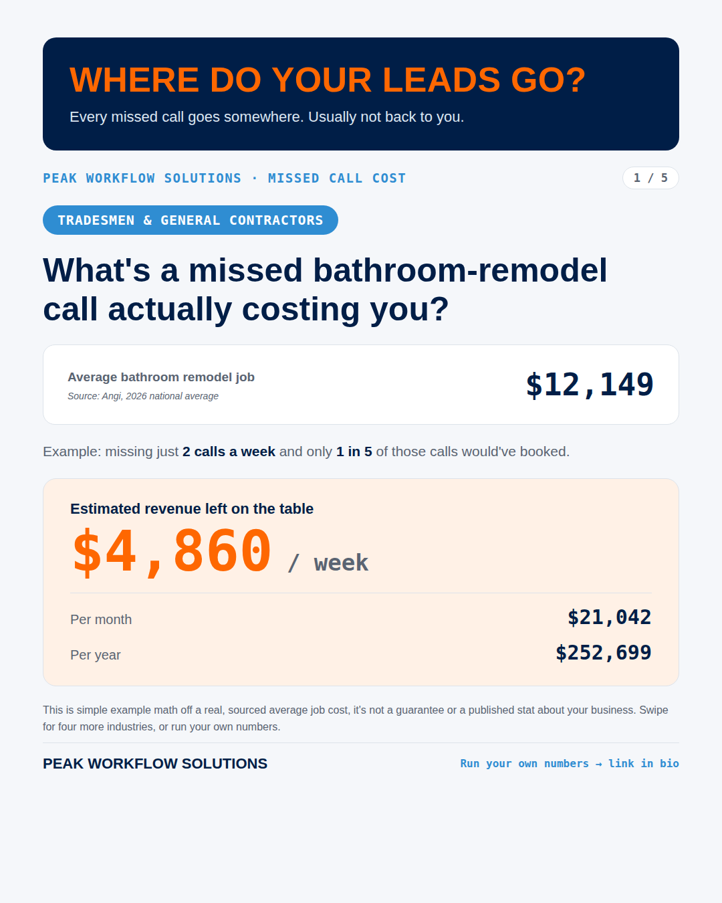
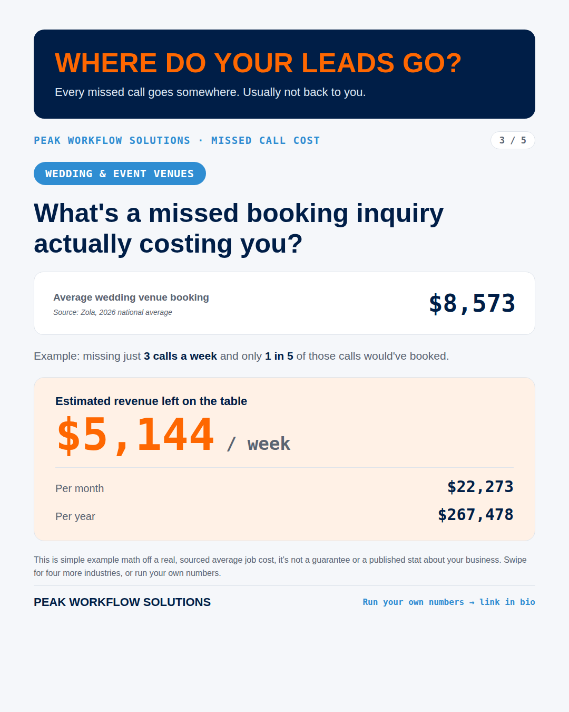

# Industry Missed-Call Cost Carousel (Graphics Generator)

**Status:** Complete. Built as a 5-slide Instagram / Facebook carousel.

A small templating pipeline that turns one HTML template and a list of industries into a set of branded 1080×1350 social graphics, one slide per industry, so people can scroll and find their own trade.

| | |
|---|---|
|  |  |

## How it works

1. [`template.html`](template.html) holds the slide layout with `{{PLACEHOLDERS}}`.
2. [`build.py`](build.py) fills in each industry's data and writes one HTML file per slide.
3. Headless Chromium renders each to PNG:
   ```bash
   python3 build.py
   for f in post19_*.html; do
     chromium --headless=new --hide-scrollbars --window-size=1080,1350 \
       --screenshot="${f%.html}.png" "file://$PWD/$f"
   done
   ```

## No made-up numbers

Each industry's average job value comes from a cited source (Angi for remodels, Zola for wedding venues, and so on), with a realistic missed-calls-per-week assumption per industry instead of one number stretched across all five. Every slide says plainly that the figure is example math off a real average, not a guarantee.
