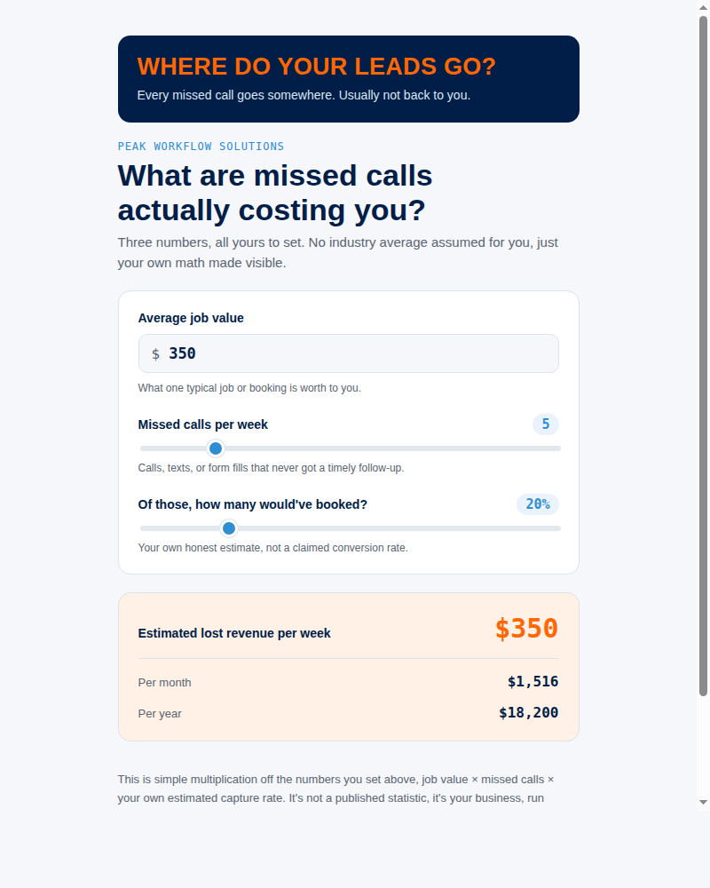

# Missed-Call Cost Calculator

**Status:** Complete. Published and used in marketing.

An interactive single-file web tool that shows a business owner what missed calls cost them. Three sliders:

- Average job value
- Missed calls per week
- How many of those calls would have booked

It outputs the estimated weekly, monthly, and yearly revenue walking out the door.

## Built with

- Plain HTML, CSS, and vanilla JavaScript in one file, no dependencies
- Brand color tokens with automatic light and dark mode
- Responsive down to phone width

Open [index.html](index.html) in a browser to use it.

Companion piece: [industry-cost-carousel](../industry-cost-carousel/), the same math rendered as static social graphics per industry.
